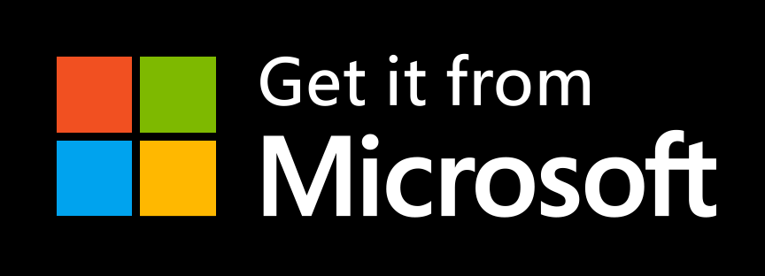

<p align="center">
  
</p>

# Spooky View
A Windows application to make any window transparent.

> **Fork notice:** This is the SchwartzKamel hardened fork of
> [littletijn/spooky-view](https://github.com/littletijn/spooky-view).
> See [docs/SECURITY-AUDIT-2026.md](docs/SECURITY-AUDIT-2026.md) for the
> security review and [Changelog.txt](Changelog.txt) for changes.

## System requirements
This application will run on Windows XP and newer.

## Downloads

> ⚠️ **Fork download notice:** The logo above, the Microsoft Store badge,
> and the GitHub releases link below all currently point at the **upstream**
> [`littletijn/spooky-view`](https://github.com/littletijn/spooky-view)
> project and its Microsoft Store listing. They do **not** distribute this
> hardened fork. To get builds of this fork, use the GitHub Releases of
> [`SchwartzKamel/spooky-view`](https://github.com/SchwartzKamel/spooky-view/releases)
> instead of the upstream Store package.

The application is available from the Microsoft Store and Github.

### Microsoft Store
<a href="https://apps.microsoft.com/store/detail/spooky-view/9PB88ZKT0CDB">
  
</a>

### Github
https://github.com/littletijn/spooky-view/releases

When downloading from Github, make sure to choose the correct version.

- For 64-bits Windows, download the x64 version to make sure that x64 based apps can also be set transparent.
- For 32-bits Windows, download the x86 version. Use this version only on 32-bits computers. 
- For Windows 10 or 11 Arm-based PCs, download the ARM64 version for the best performance. 

## Known issues
- WPF (Windows Presentation Foundation) apps cannot be set transparent.
- When stopping Spooky View, some apps will not return opaque. Restart the affected apps to revert them.
- Only when Spooky View is run as administrator will it be able to make high privileges app transparent, like Windows Task Manager.

## Logging & Diagnostics

- Log file: `%LOCALAPPDATA%\SpookyView\spookyview.log`. The log rotates at
  ~1 MiB to `spookyview.log.old`. It is written locally and is never
  uploaded anywhere by the app.
- On an unhandled crash, a minidump named
  `spookyview-crash-YYYYMMDD-HHMMSS-PID.dmp` is written to the same
  directory by an internal Vectored Exception Handler. Windows Error
  Reporting (WER) `LocalDumps` can additionally be enabled as a backup.

### Troubleshooting

- If a dialog doesn't open or the app exits unexpectedly, check
  `spookyview.log` and any `.dmp` file in `%LOCALAPPDATA%\SpookyView\`.

## FAQ

### How do I enable automatic startup of Spooky View?

It depends on the installed version. When using the MSI or portable version:
- Start Spooky View.
- Right click on the icon of the app in the Notification Area.
- Click on the "Settings..." option in the menu.
- Check the option "Start program when this user logs in".
- Click on "OK" button to save the changes and enable automatic startup.

When downloaded from the Microsoft Store or using the MSIX version:
- Open the Settings app of Windows.
- Click the "Apps" category.
- Click on the "Startup" option.
- Set the slider to enabled for the Spooky View item in the list of apps.

### How can I make high privileges apps (apps started as administrator) transparent?

When the app is installed from the Microsoft Store, MSIX or MSI:
- Find the app in the start menu.
- Right click on the app.
- Click on the "Run as administrator" option.

When the portable app is downloaded and extracted:
- Find the executable of the app (SpookyView_version_Portable.exe).
- Right click on the icon of the executable.
- Click on the "Run as administrator" option.

## Building

See [BUILDING.md](BUILDING.md) for full toolchain setup, including
Chocolatey / Scoop one-liners to install MinGW-w64 + GNU make.

Quick paths:

* **Visual Studio 2022** — install *Desktop Development with C++* plus the
  *C++ Windows XP Support for VS 2017 (v141) tools* component, then open
  `SpookyView.sln` and build the `SpookyView` project.
* **MinGW-w64** (Debug only) — from the repo root:

  ```
  make restore
  make
  ```

  A VS Code build task (`Build Debug version with MinGW-w64`) is also
  provided.

## Continuous fuzzing

The portable, fuzz-amenable code paths (URL allowlist, update-response JSON
post-parse extraction, and the `WM_COPYDATA` payload validator) are exercised
by libFuzzer harnesses under [`fuzz/`](fuzz/README.md). The same harnesses are
wired into ClusterFuzzLite (in-repo GitHub Actions, see
[`.clusterfuzzlite/`](.clusterfuzzlite)) and ready for submission to upstream
OSS-Fuzz (see [`docs/oss-fuzz/`](docs/oss-fuzz)). The full continuous-fuzzing
guide — local repro, crash triage, adding new harnesses — lives in
[`docs/OSS-FUZZ.md`](docs/OSS-FUZZ.md).

## License
Spooky View is licensed under the GNU GPL v3.0 or later. See the LICENSE file for more details.
